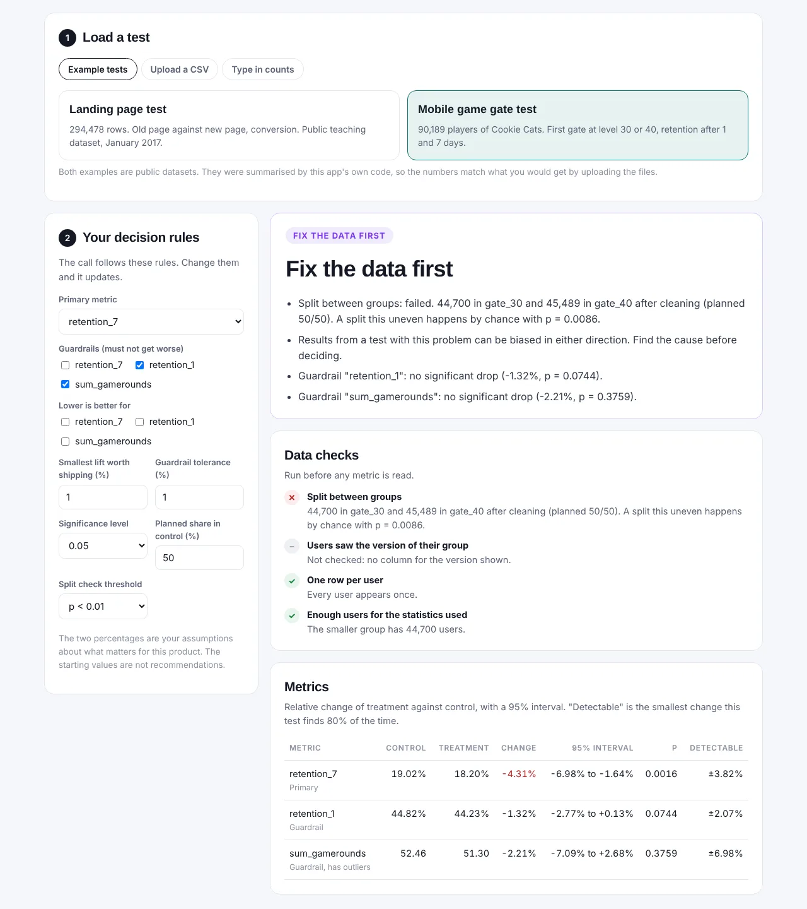

# Experiment Readout

**Check an A/B test before you trust it. Load a result and get one of four calls with the reasons: ship, don't ship, run longer, or fix the data first.**

**Current version:** 0.1.0

Live demo: https://kostasxeras.com/experiment-readout/



## Why this exists

A/B test readouts often go straight to the headline number: "the new version lifted conversion by 2%". The checks that decide whether that number can be trusted come later, or not at all. Was the traffic split the way it was planned? Did users actually see the version of their group? Did the same user end up in both groups? And when nothing is significant, nobody asks whether the test was large enough to find the effect the team cared about.

This app puts the checks first and makes the decision rules explicit. The product manager states the smallest lift worth shipping and how much a guardrail metric may drop. The app applies those rules and says which one decided the call.

## What it does

- Loads a test three ways: two public example tests, your own CSV (one row per user, read in the browser, never uploaded), or four typed-in counts.
- Runs four data checks before reading any metric: group split against the plan (sample ratio mismatch), users who saw the wrong version, users who appear more than once, and sample size. It also flags metrics with extreme outliers.
- Compares every metric with a 95% interval, a p-value, and the smallest change the test could reliably detect.
- Gives one call with the reasons:
  - **Fix the data first** if the split check fails or more than 5% of rows show the wrong version.
  - **Don't ship** if the primary metric got worse, a guardrail dropped more than your tolerance, or the interval rules out the lift you need.
  - **Ship** if the primary metric improved and no guardrail broke.
  - **Run longer** if the result is unclear, with an estimate of how many more users are needed.
- Updates the call as soon as you change a rule, so you can see which assumption the decision depends on.
- Shows the primary metric by day when the data has timestamps.

## Main findings

Full detail in the [case study](docs/case-study.md). Both examples are public teaching datasets.

- **Mobile game gate test (Cookie Cats, 90,189 players):** the call is "fix the data first". The groups are 44,700 and 45,489 players. With a planned 50/50 split, a gap this large happens by chance with p = 0.0086. If that check is ignored, 7-day retention fell from 19.02% to 18.20% (p = 0.0016). That is a real effect only if the split problem has a harmless cause.
- **Landing page test (294,478 rows):** the call is "don't ship". 3,893 rows showed the wrong page and 3,894 users appeared more than once. After removing them, conversion was 12.02% for the old page and 11.87% for the new one (p = 0.23). The 95% interval (−3.18% to +0.77%) rules out a lift of 1% or more.
- Changing one rule changes the landing page call. If a 0.5% lift were worth shipping, the call becomes "run longer", and the test would need about 32 times as many users to find it.

## How the statistics work

- Rates (0/1 metrics): two-proportion z-test with a pooled standard error for the p-value and an unpooled one for the interval.
- Averages: Welch's test with a normal approximation.
- Group split: chi-square goodness-of-fit against the planned share.
- Detectable change: the smallest true difference found 80% of the time at your significance level.
- The numbers are checked against SciPy on both example datasets (`tests/check-against-scipy.py`, 6 of 6 pass).

Limits: one primary metric and one comparison per test, no correction for looking at several metrics, and no sequential testing. A test that was checked every day and stopped early needs a different method. The decision rules are mine and are written out in [docs/decisions](docs/decisions).

## Data

- Landing page test: a public teaching dataset of an e-commerce landing page test from the Udacity Data Analyst course (January 2017). Licence not stated.
- Cookie Cats: public player-level data from the mobile game Cookie Cats by Tactile Entertainment, shared for teaching by DataCamp. Licence not stated.
- The raw files are not in this repo. `data/demo-*.json` holds the summaries the app's own engine produced from them (`scripts/build-demos.js`).

## How it was built

I framed the problem, chose the checks, set the decision rules and wrote the findings. Claude (Anthropic) was my engineering partner for the code. Decisions are recorded in [docs/decisions](docs/decisions).

## Run it locally

Open `index.html` through any local web server, for example `python3 -m http.server`, then go to http://localhost:8000. To rebuild the examples, put the two CSV files in `scripts/` and run `npm run demos`. To run the SciPy check: `python3 tests/check-against-scipy.py <ab_data.csv> <cookie_cats.csv>`.

## Repo layout

```
index.html                     The app (interface)
engine.js                      Cleaning, checks, statistics and decision rules
data/demo-*.json               Summaries of the two example tests
scripts/build-demos.js         Builds the summaries from the public CSV files
tests/check-against-scipy.py   Compares the engine with SciPy
docs/product-brief.md          Users, goals, scope
docs/case-study.md             Question, approach, findings, next steps
docs/decisions/                One record per real trade-off
docs/versioning.md             How releases work
```
